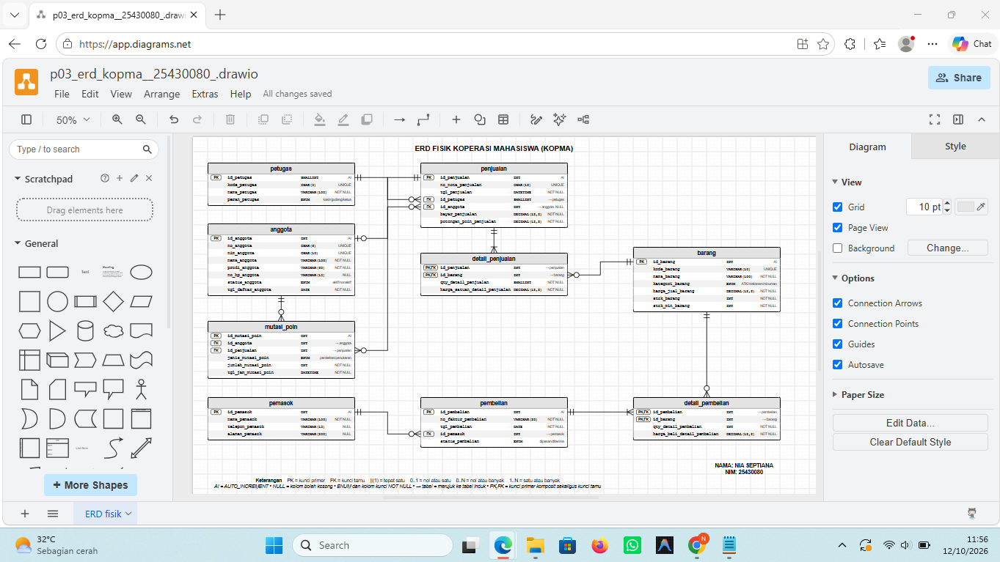
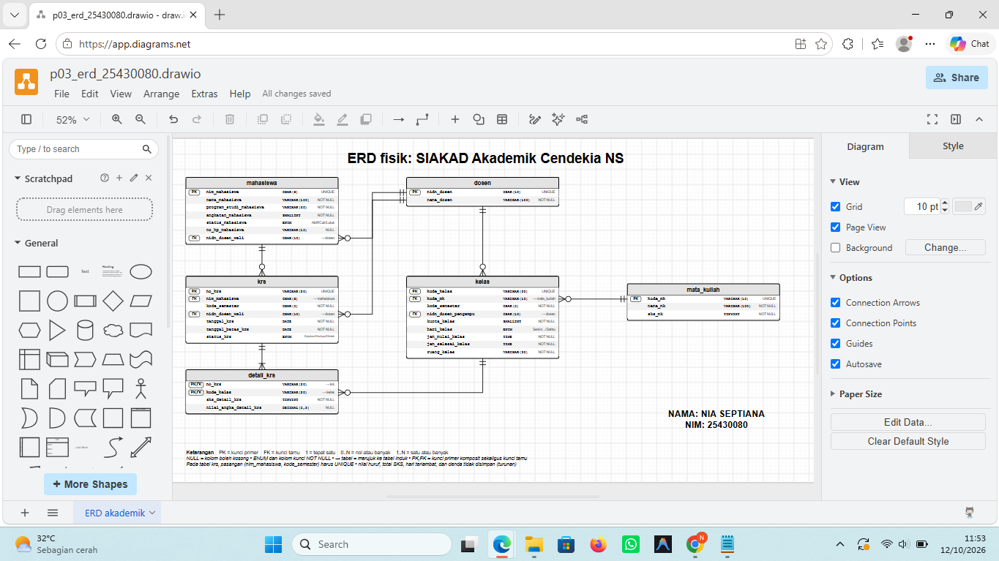

# Laporan Praktikum Basis Data - Pertemuan 03
**Nama:** Nia Septiana
**NIM:** 25430080
**Kelas:** C
**Tanggal:** 13 Oktober 2026
**Dosen Pengampu:** Dedi Irawan, S.Kom, M.T.I  

## 1. Tujuan Praktikum
* Memahami konsep pemodelan data konseptual, logikal, dan fisik menggunakan Entity-Relationship Diagram (ERD).
* Mentransformasikan spesifikasi kebutuhan data menjadi rancangan entitas, atribut, dan relasi yang ternormalisasi untuk studi kasus Kopma maupun proyek mandiri.
* Menentukan Primary Key (PK), Foreign Key (FK), kunci alternatif, dan tipe data yang presisi berdasarkan kamus data.
* Menangani relasi Many-to-Many melalui pembentukan entitas asosiatif (detail_penjualan, detail_pembelian, dan detail_krs).  
* Menggambarkan ERD fisik menggunakan perangkat lunak draw.io dengan notasi Crow's Foot sesuai standar praktikum. 

## 2. Ringkasan Dasar Teori
* **Entity-Relationship Diagram (ERD):** Model visual yang merepresentasikan struktur data sistem dengan mendefinisikan objek-objek berwujud atau abstrak (*entitas*), karakteristik objek tersebut (*atribut*), serta bentuk interaksi antrobjek (*relasi*).
* **Kardinalitas Relasi:** Batasan jumlah instans suatu entitas yang dapat terhubung dengan instans entitas lainnya. Bentuk kardinalitas utama meliputi *One-to-One* (1:1), *One-to-Many* (1:N), dan *Many-to-Many* (M:N).
* **Entitas Asosiatif (Associative Entity):** Entitas perantara yang wajib dibuat untuk memecah relasi *Many-to-Many* langsung guna menghindari anomali data serta menampung atribut spesifik dari transaksi (misalnya jumlah barang dan harga satuan saat transaksi).
* **Partisipasi / Opsionalitas (*Participation*):** Aturan yang menentukan apakah keberadaan suatu entitas dalam relasi bersifat wajib (*Mandatory*, digambarkan dengan garis lurus atau tanda batas vertikal) atau opsional (*Optional*, digambarkan dengan lingkaran kecil).
* **Constraint Basis Data:** Aturan integritas yang melekat pada skema fisik seperti `PRIMARY KEY`, `FOREIGN KEY`, `UNIQUE`, `NOT NULL`, `DEFAULT`, `CHECK`, dan *Auto Increment* (`AI`).

## 3. Hasil Langkah Percobaan
Berikut adalah hasil tangkapan layar dari rancangan ERD fisik **Koperasi Mahasiswa (Kopma)** yang telah digambar dan divalidasi menggunakan aplikasi *draw.io*:

*Keterangan Komponen Diagram:*
* **Tabel Master:** `petugas`, `anggota`, `barang`, dan `pemasok` sebagai entitas induk penyedia referensi data utama.
* **Tabel Transaksi Utama:** `penjualan` (pencatatan nota kasir) dan `pembelian` (pencatatan faktur barang dari pemasok).
* **Tabel Asosiatif:** `detail_penjualan` dan `detail_pembelian` yang menghubungkan transaksi induk dengan data barang secara *Many-to-Many*.
* **Tabel Audit Khusus:** `mutasi_poin` untuk mencatat riwayat perolehan dan penukaran poin loyalitas anggota secara transparan dan akuntabel.

## 4. Jawaban Titik Analisis
1. **Mengapa relasi *Many-to-Many* antara entitas `penjualan` dan `barang` harus dipecah menjadi entitas asosiatif (`detail_penjualan`)?**  
   *Jawab:* Karena satu nota penjualan dapat memuat banyak jenis barang, dan satu jenis barang dapat terjual di banyak nota berbeda dalam waktu yang berlainan. Jika relasi ini dipaksakan langsung tanpa tabel perantara, akan terjadi *multivalued attribute* yang melanggar aturan normalisasi basis data. Dengan adanya entitas asosiatif `detail_penjualan`, relasi pecah menjadi dua buah hubungan *One-to-Many* ($1:N$), sekaligus memungkinkan penyimpanan atribut turunan transaksi seperti jumlah barang (`qty`) dan harga satuan saat transaksi (*snapshot* harga historis).
2. **Bagaimana penerapan aturan bisnis terkait poin loyalitas direpresentasikan ke dalam struktur ERD?**  
   *Jawab:* Aturan bisnis poin (seperti perolehan poin dari total belanja dan penukaran poin menjadi potongan harga) direpresentasikan melalui pembuatan entitas khusus bernama `mutasi_poin`. Entitas ini berelasi secara *One-to-Many* dengan tabel `anggota` (untuk melacak kepemilikan saldo poin) dan tabel `penjualan` (untuk memastikan setiap mutasi poin terikat secara audit pada nota transaksi yang sah).
3. **Apa fungsi utama dari pemberian tipe data yang spesifik (seperti `DECIMAL`, `ENUM`, atau `CHAR`) pada perancangan ERD fisik?**  
   *Jawab:* Penggunaan tipe data yang tepat memastikan integritas domain data terjaga sejak dini—misalnya `DECIMAL(12,2)` untuk presisi nilai mata uang rupiah agar tidak terjadi pembulatan desimal yang keliru, `ENUM` untuk membatasi pilihan data yang bernilai tetap (seperti peran petugas atau status keanggotaan), serta `CHAR` dengan panjang tetap untuk kode identifikasi terstandar.
4. **Pemetaan Entitas ke Proses Bisnis (PB) / Kebutuhan Informasi (KI) dan Alasan Kardinalitas Relasi Utama**  
   * **Pemetaan ke PB/KI (Studi Kasus Kopma):**
     * `petugas` dipetakan ke **PB-02** (pencatatan penjualan) serta mendukung penelusuran kasir pada **KI-01** & **KI-04**.
     * `anggota` dipetakan ke **PB-01** (pendaftaran) dan **PB-08** (status aktif), serta mendukung **KI-04** (anggota belanja terbesar) dan **KI-05** s.d. **KI-07** (poin loyalitas).
     * `barang` dipetakan ke **PB-02**, **PB-03**, **PB-04**, **PB-07**, serta mendukung **KI-02** (barang terlaris) dan **KI-03** (stok minimum).
     * `pemasok` & `pembelian`/`detail_pembelian` dipetakan ke **PB-03** (pemesanan) dan **PB-04** (penerimaan barang).
     * `penjualan`/`detail_penjualan` dipetakan ke **PB-02** serta menjadi fondasi utama **KI-01** (omzet), **KI-02**, dan **KI-04**.
     * `mutasi_poin` dipetakan ke **PB-02** dan menyokong penuh **KI-05** hingga **KI-07** (mutasi dan rekapitulasi poin).
   * **Alasan Kardinalitas Relasi Utama:**
     * `petugas` ke `penjualan` ($1 : N$): Seorang petugas dapat melayani banyak nota penjualan, namun satu nota penjualan wajib dilayani oleh tepat satu petugas yang bertugas (*mandatory*).
     * `anggota` ke `penjualan` ($0..1 : N$): Penjualan boleh tanpa anggota (pembeli umum), sehingga sisi anggota bersifat opsional ($0..1$); satu anggota dapat melakukan banyak transaksi pembelian.
     * `penjualan` ke `detail_penjualan` ($1 : 1..N$): Setiap nota minimal harus memuat satu baris barang (*satu atau banyak*) untuk menghindari nota kosong.
     * `anggota` ke `mutasi_poin` ($1 : 0..N$): Seorang anggota dapat memiliki banyak riwayat mutasi poin atau belum memiliki riwayat sama sekali jika baru terdaftar.

## 5. Hasil Latihan dan Modul Modifikasi
* Melakukan dekomposisi entitas kandidat gabungan dari dokumen kebutuhan data (seperti memisahkan kepala transaksi `penjualan` dengan baris `detail_penjualan`, serta kepala faktur `pembelian` dengan baris `detail_pembelian`).
* Menambahkan kolom audit khusus `potongan_poin_penjualan` pada tabel `penjualan` guna merekam besaran rupiah potongan poin secara permanen pada saat transaksi terjadi (selaras dengan aturan bisnis AB-10).
* Menyusun skema relasi kunci tamu (*Foreign Key*) lengkap dengan aksi referensial untuk memastikan tidak ada data yatim (*orphan records*).

## 6. Tugas Mandiri: Milestone Proyek 3
* Menyelesaikan perancangan diagram ERD konseptual dan fisik secara komprehensif untuk sistem Akademik Cendekia NS berdasarkan dokumen kebutuhan data Modul 2
* Melakukan penelusuran balik (traceability) untuk memastikan seluruh daftar Kebutuhan Informasi (KI-01 sampai KI-05) dari proyek Akademik Cendekia NS dapat dijawab melalui jalur relasi antartabel di dalam ERD ini (meliputi tabel mahasiswa, dosen, mata_kuliah, kelas, krs, dan detail_krs).
* Menyiapkan dokumentasi diagram proyek ke dalam format file sumber (.drawio) dan gambar visual (.png).
* Tangkapan layar ERD proyek Akademik Cendekia NS di draw.io:
 

## 7. Pembahasan dan Kendala
* Pembahasan Praktikum: Pemodelan data menuntut ketelitian tinggi dalam menerjemahkan aturan bisnis naratif ke dalam skema relasional. Pemisahan master data dari data operasional/transaksional berhasil mencegah anomali pembaruan (seperti perubahan harga barang atau kurikulum SKS yang tidak boleh merusak riwayat transaksi/KRS masa lalu)

* Kendala dan Solusi: Sempat menemui keraguan dalam menentukan arah relasi opsional (seperti pembeli umum pada Kopma yang tidak wajib berstatus anggota, atau hubungan dosen wali pada mahasiswa). Hal ini diselesaikan dengan menetapkan kardinalitas partisipasi opsional (0..1 ke 0..N) serta mengizinkan nilai NULL pada kolom kunci tamu yang bersangkutan

## 8. Kesimpulan
Pembuatan Entity-Relationship Diagram (ERD), baik untuk studi kasus Koperasi Mahasiswa (Kopma) maupun proyek mandiri Akademik Cendekia NS, telah berhasil diselesaikan dengan baik dan selaras dengan kaidah normalisasi. Seluruh komponen seperti entitas, atribut, kunci primer (primary key), kunci tamu (foreign key), serta pola kardinalitas Crow's Foot telah teruji valid dalam mendukung berbagai kebutuhan informasi operasional sistem. Hasil rancangan ERD fisik ini pun kini telah siap untuk digunakan sebagai pedoman utama dalam menyusun skrip DDL (Data Definition Language) pada tahapan praktikum selanjutnya.

## 9. Pernyataan Penggunaan AI
Saya menyatakan bahwa dalam penyusunan laporan dan perancangan diagram praktikum ini, saya memanfaatkan alat bantu kecerdasan buatan (AI) sebagai sarana konsultasi referensi teoretis, pengecekan tata bahasa, dan panduan penataan struktur dokumen. Seluruh hasil analisis, penyesuaian kasus Kopma, dan validasi diagram dikerjakan, diverifikasi, dan diuji secara mandiri.

## 10. Bukti Git
* **Tautan Repositori:** [https://github.com/niaseptiana/basisdata_25430080]
* **Hash Commit Terakhir:** [6cd05dc242f9e57d0c2c5758486fe634879fbe68] 

## Checklist
- [x] Menyiapkan perangkat lunak draw.io dan memahami standar notasi Crow's Foot.
- [x] Memetakan seluruh entitas kandidat dan atribut dari Dokumen Kebutuhan Data(Kopma dan Akademik Cendekia NS).
- [x] Menentukan Primary Key, Foreign Key, dan tipe data yang presisi pada setiap kolom tabel.
- [x] Menangani relasi Many-to-Many dengan membangun entitas asosiatif (*detail_penjualan*, *detail_pembelian*, dan *detail_krs*).
- [x] Menambahkan entitas khusus audit *mutasi_poin* sesuai dengan kompleksitas aturan bisnis sistem Kopma.
- [x] Menggambar ERD fisik secara lengkap, rapi, dan terstruktur di dalam aplikasi draw.io.
- [x] Mengekspor diagram menjadi berkas gambar visual (.png).
- [x] Menyusun laporan praktikum format Markdown secara lengkap sesuai dengan struktur baku.
- [x] Melakukan *commit* dan *push* seluruh berkas milestone ke repositori GitHub.