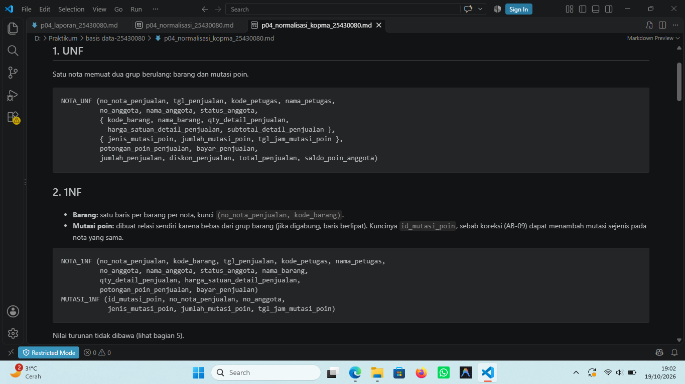
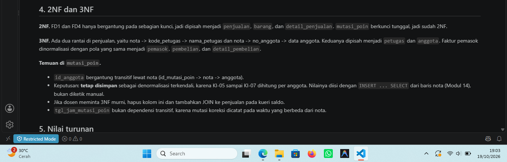
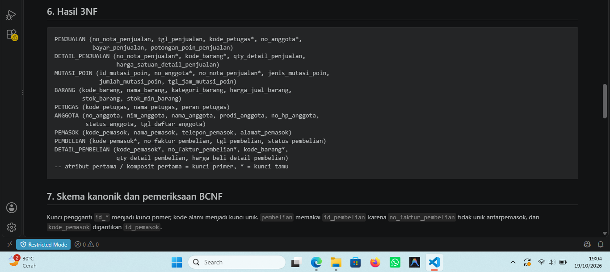
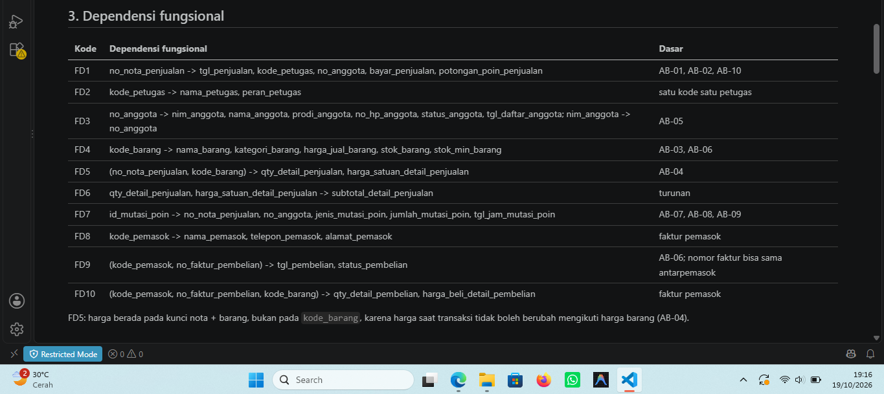
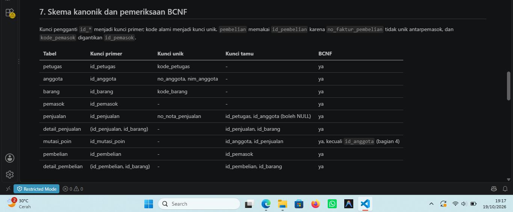
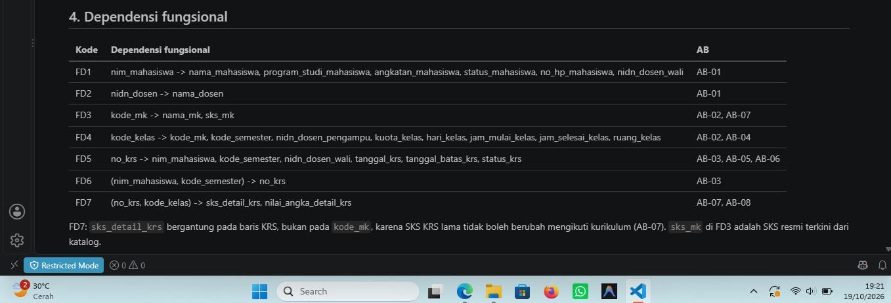
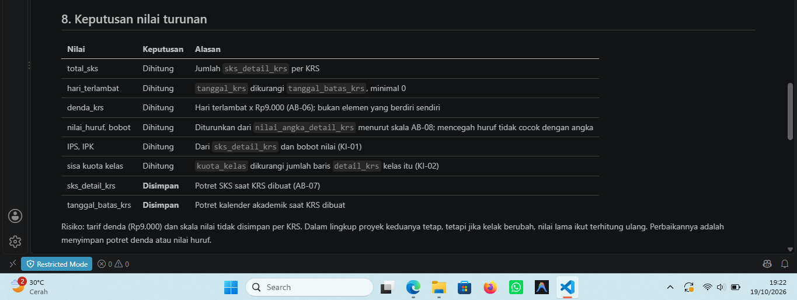

# Laporan Praktikum Basis Data - Pertemuan 04

**Nama:** Nia Septiana
**NIM:** 25430080
**Kelas:** C
**Tanggal:** 20 Oktober 2026
**Dosen Pengampu:** Dedi Irawan, S.Kom, M.T.I  

## 1. Tujuan Praktikum

Pada pertemuan ini saya berlatih mengenali anomali pada data yang belum dinormalisasi, menuliskan dependensi fungsional dari aturan bisnis, dan menormalisasi relasi sampai 3NF serta memeriksa BCNF. Saya juga memutuskan apakah suatu nilai turunan disimpan atau dihitung, lalu mendokumentasikan skema relasional akhir untuk kasus Kopma dan proyek SIAKAD.

## 2. Ringkasan Dasar Teori

Data yang disimpan berulang dalam satu tabel menimbulkan anomali ubah, sisip, dan hapus. Normalisasi menghilangkannya secara bertahap: 1NF menghapus grup berulang, 2NF menghapus ketergantungan pada sebagian kunci, dan 3NF menghapus ketergantungan antaratribut non-kunci (rantai A -> B -> C). BCNF lebih ketat: setiap penentu harus kunci kandidat. Dependensi fungsional (A -> B) diturunkan dari aturan bisnis, bukan dari contoh data, karena contoh hanya bisa membantah dependensi, tidak membuktikannya. Nilai turunan sebaiknya dihitung agar tidak menyimpang dari sumbernya, kecuali nilai itu merupakan potret saat kejadian.

## 3. Hasil Langkah Percobaan (tangkapan layar + keterangan)

Berkas: `p04_normalisasi_kopma_25430080.md`.

*Keterangan: UNF, 1NF, 2NF, dan 3NF Kopma, termasuk pemisahan grup mutasi poin dari grup barang.

*Keterangan:* FD1 sampai FD10 beserta kode AB yang mendasarinya.

*Keterangan:* sembilan tabel hasil normalisasi, kunci primer, kunci unik, kunci tamu, dan hasil pemeriksaan BCNF.

## 4. Jawaban Titik Analisis

**Titik Analisis 1.** FD5 menempatkan `harga_satuan_detail_penjualan` pada kunci `(no_nota_penjualan, kode_barang)` karena AB-04: harga di nota adalah harga saat transaksi dan tidak berubah meski harga barang kemudian naik. Harga satu barang bisa berbeda antarnota (misalnya pulpen Rp4.000 lalu Rp4.500), sehingga harga tidak ditentukan oleh `kode_barang` saja. Jika harga dipindah ke tabel barang, setiap kenaikan harga ikut mengubah nilai semua nota lama. Laporan omzet tahun lalu akan dihitung ulang dengan harga hari ini, angkanya berubah, dan nota lama tidak dapat diverifikasi lagi.

**Titik Analisis 2.** Di Kopma operasional, total sebaiknya dihitung karena sumbernya (detail, status anggota, potongan poin) masih bisa dikoreksi, dan total yang disimpan bisa berbeda dari rinciannya. Pada tabel arsip penjualan di Buku 2, isinya adalah potret historis yang sudah final dan tidak boleh berubah, sehingga total yang disimpan tidak mungkin menyimpang dan laporan menjadi lebih cepat. Prinsipnya sama: nilai turunan boleh disimpan hanya bila sumbernya tidak lagi berubah atau memang potret saat kejadian. Karena itu kedua keputusan tidak bertentangan.

**Titik Analisis 3.** Informasi "barang ini dipasok oleh siapa" kini disimpan lewat riwayat pembelian: `detail_pembelian` menghubungkan barang dengan faktur, dan `pembelian` menyimpan `id_pemasok`. Keuntungannya dibanding satu nama pemasok di tabel barang: satu barang bisa dibeli dari banyak pemasok dari waktu ke waktu, Kopma bisa berganti pemasok tanpa mengubah data barang, harga beli dan tanggal tercatat per faktur, dan nama pemasok tidak berulang di banyak baris sehingga tidak ada anomali ubah ejaan.

### Analisis Wajib P4

**A. Daftar dependensi fungsional**

*Kopma*

| Kode | Dependensi fungsional | Dasar |
|---|---|---|
| FD1 | no_nota_penjualan -> tgl_penjualan, kode_petugas, no_anggota, bayar_penjualan, potongan_poin_penjualan | AB-01, AB-02, AB-10 |
| FD2 | kode_petugas -> nama_petugas, peran_petugas | satu kode satu petugas |
| FD3 | no_anggota -> nim_anggota, nama_anggota, prodi_anggota, no_hp_anggota, status_anggota, tgl_daftar_anggota; nim_anggota -> no_anggota | AB-05 |
| FD4 | kode_barang -> nama_barang, kategori_barang, harga_jual_barang, stok_barang, stok_min_barang | AB-03, AB-06 |
| FD5 | (no_nota_penjualan, kode_barang) -> qty_detail_penjualan, harga_satuan_detail_penjualan | AB-04 |
| FD6 | qty_detail_penjualan, harga_satuan_detail_penjualan -> subtotal_detail_penjualan | turunan |
| FD7 | id_mutasi_poin -> no_nota_penjualan, no_anggota, jenis_mutasi_poin, jumlah_mutasi_poin, tgl_jam_mutasi_poin | AB-07, AB-08, AB-09 |
| FD8 | kode_pemasok -> nama_pemasok, telepon_pemasok, alamat_pemasok | faktur pemasok |
| FD9 | (kode_pemasok, no_faktur_pembelian) -> tgl_pembelian, status_pembelian | AB-06 |
| FD10 | (kode_pemasok, no_faktur_pembelian, kode_barang) -> qty_detail_pembelian, harga_beli_detail_pembelian | faktur pemasok |

*SIAKAD*

| Kode | Dependensi fungsional | AB |
|---|---|---|
| FD1 | nim_mahasiswa -> nama_mahasiswa, program_studi_mahasiswa, angkatan_mahasiswa, status_mahasiswa, no_hp_mahasiswa, nidn_dosen_wali | AB-01 |
| FD2 | nidn_dosen -> nama_dosen | AB-01 |
| FD3 | kode_mk -> nama_mk, sks_mk | AB-02, AB-07 |
| FD4 | kode_kelas -> kode_mk, kode_semester, nidn_dosen_pengampu, kuota_kelas, hari_kelas, jam_mulai_kelas, jam_selesai_kelas, ruang_kelas | AB-02, AB-04 |
| FD5 | no_krs -> nim_mahasiswa, kode_semester, nidn_dosen_wali, tanggal_krs, tanggal_batas_krs, status_krs | AB-03, AB-05, AB-06 |
| FD6 | (nim_mahasiswa, kode_semester) -> no_krs | AB-03 |
| FD7 | (no_krs, kode_kelas) -> sks_detail_krs, nilai_angka_detail_krs | AB-07, AB-08 |

**B. Keputusan menyimpan atau menghitung nilai turunan**

*Kopma*

| Nilai | Keputusan | Alasan |
|---|---|---|
| subtotal_detail_penjualan | Dihitung | qty x harga; menyimpan berisiko tidak konsisten |
| jumlah_penjualan, total_penjualan | Dihitung | Bisa dihitung ulang dari detail, diskon, dan potongan poin |
| diskon_penjualan (5%) | Dihitung | Turunan dari status anggota aktif (AB-02) |
| saldo_poin_anggota | Dihitung | Jumlah seluruh mutasi poin; riwayat tidak dihapus (AB-09) |
| potongan_poin_penjualan | Disimpan | Potret nilai saat transaksi (AB-10) |
| jumlah_mutasi_poin | Disimpan | Fakta historis yang bergantung pada status dan aturan saat transaksi (AB-07, AB-08) |

*SIAKAD*

| Nilai | Keputusan | Alasan |
|---|---|---|
| total_sks | Dihitung | Jumlah `sks_detail_krs` per KRS |
| hari_terlambat | Dihitung | `tanggal_krs` dikurangi `tanggal_batas_krs`, minimal 0 |
| denda_krs | Dihitung | Hari terlambat x Rp9.000 (AB-06) |
| nilai_huruf, bobot | Dihitung | Diturunkan dari nilai angka menurut skala AB-08; mencegah huruf tidak cocok dengan angka |
| IPS, IPK | Dihitung | Dari `sks_detail_krs` dan bobot nilai (KI-01) |
| sisa kuota kelas | Dihitung | `kuota_kelas` dikurangi jumlah baris `detail_krs` kelas itu (KI-02) |
| sks_detail_krs | Disimpan | Potret SKS saat KRS dibuat (AB-07) |
| tanggal_batas_krs | Disimpan | Potret kalender akademik saat KRS dibuat |

## 5. Hasil Latihan dan Modifikasi

Berkas: `p04_normalisasi_kopma_25430080.md`, bagian 9.

- **Latihan 1 (beberapa telepon per pemasok):** nomor telepon dipindah ke relasi `TELEPON_PEMASOK` (kunci komposit, tanpa atribut non-kunci) sehingga memenuhi 1NF sampai BCNF. Di skema kanonik menjadi tabel `telepon_pemasok` dengan kunci primer `id_telepon_pemasok` dan kunci unik `(id_pemasok, no_telepon_pemasok)`.
- **Latihan 2 (`nama_anggota` di penjualan):** menimbulkan rantai `id_penjualan -> id_anggota -> nama_anggota` yang melanggar 3NF. Pembaruan nama pada satu nota saja membuat satu anggota tercatat dengan dua nama, tanpa galat dari server. Hasil kueri di berkas adalah hasil yang diharapkan.

## 6. Tugas Mandiri: Milestone Proyek 04

Berkas: `p04_normalisasi_25430080.md` (proyek SIAKAD Akademik Cendekia NS, P = 9).

- Dokumen sumber: KRS (P2 bagian 3.1), dilengkapi data kelas dari jadwal kuliah.
- Tujuh dependensi fungsional (FD1 sampai FD7), masing-masing dikaitkan ke AB-01 sampai AB-08.
- Hasil 3NF: `mahasiswa`, `dosen`, `mata_kuliah`, `kelas`, `krs`, `detail_krs`; seluruhnya lolos BCNF.
- Nilai turunan dihitung: total SKS, hari terlambat, denda, nilai huruf, IPS/IPK, sisa kuota. Disimpan sebagai potret: `sks_detail_krs` (AB-07) dan `tanggal_batas_krs`.
- ERD P3 tidak berubah karena sudah sesuai hasil 3NF.

## 7. Pembahasan dan Kendala

Pertemuan ini berupa kerja analisis, sehingga tidak ada pesan galat dari server. Kendala yang ditemui dan cara mengatasinya:

- **Dua grup berulang pada satu nota (Kopma).** Barang dan mutasi poin saling bebas; jika digabung dalam satu relasi 1NF, baris menjadi berlipat. Saya memisahkan mutasi poin menjadi relasi sendiri dengan kunci `id_mutasi_poin`.
- **Dependensi transitif pada `mutasi_poin`.** `id_anggota` dapat dibaca lewat nota. Saya mempertahankannya sebagai denormalisasi terkendali karena KI-05 sampai KI-07 dihitung per anggota, dan nilainya diisi dari baris nota lewat transaksi (Modul 14).
- **Risiko nilai yang dihitung.** Diskon Kopma bergantung pada status anggota, sedangkan denda dan skala nilai SIAKAD bergantung pada tarif dan skala yang bisa berubah. Keduanya dicatat sebagai risiko.
- **Ketidakcocokan kamus P2 dengan ERD Kopma** (misalnya `no_faktur_pembelian` unik di kamus tetapi tidak di ERD, dan `kode_pemasok` hanya ada di kamus). Normalisasi mengikuti ERD, dan kamus perlu disamakan.

## 8. Kesimpulan

Normalisasi bertahap dari UNF sampai 3NF dan pemeriksaan BCNF mengubah rancangan awal menjadi tabel yang bebas dari anomali ubah, sisip, dan hapus. Dependensi fungsional harus bersumber dari aturan bisnis, dan nilai turunan lebih aman dihitung kecuali merupakan potret saat kejadian. Hasil normalisasi Kopma dan SIAKAD sesuai dengan ERD, dengan satu denormalisasi terkendali di `mutasi_poin`.

## 9. Pernyataan Penggunaan AI

Penggunaan asisten AI pada modul ini dimanfaatkan untuk membantu penyusunan kerangka dokumen Markdown dan konsultasi pemahaman materi bentukan normal. Seluruh perumusan FD, keputusan nilai turunan, dan skema tabel proyek dikerjakan serta diverifikasi secara mandiri.

## 10. Bukti Git

- **Repositori:** [https://github.com/niaseptiana/basisdata_25430080]
- **Commit Kopma:** `p04: normalisasi kopma.` , hash: [425a830]
- **Commit proyek:** `p04: normalisasi proyek.` , hash: [6d920ba]

## Checklist (salin dari buku, centang setelah benar-benar terpenuhi)

- [x] Berkas `p04_normalisasi_kopma_25430080.md` ada di repositori
- [x] Berkas `p04_normalisasi_25430080.md` ada di repositori
- [x] Tabel tahapan UNF, 1NF, 2NF, hingga 3NF tercantum dengan lengkap
- [x] Daftar Dependensi Fungsional (FD) dirumuskan berdasarkan aturan bisnis (AB)
- [x] Keputusan mengenai penyimpanan atau perhitungan nilai turunan dijelaskan beserta alasannya
- [x] Titik Analisis 1-3 dijawab lengkap dengan alasan
- [x] Tangkapan layar tabel tahapan UNF -> 1NF -> 2NF -> 3NF
- [x] Daftar dependensi fungsional; keputusan menyimpan atau menghitung nilai turunan beserta alasannya

