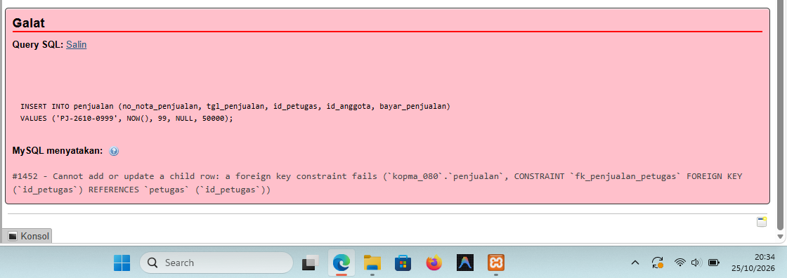
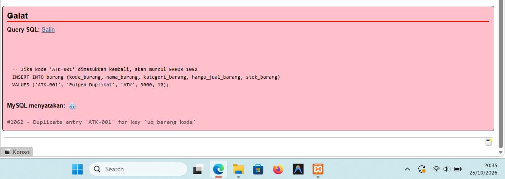
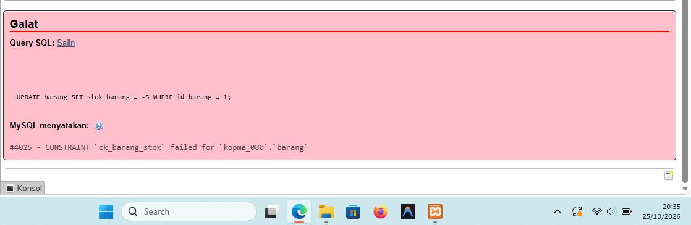

# Laporan Praktikum Basis Data - Pertemuan 5

**Nama:** Nia Septiana  
**NIM:** 25430080  
**Kelas:** C  
**Tanggal:** [26 Oktober 2026]  
**Dosen Pengampu:** Dedi Irawan, S.Kom., M.T.I.

## 1. Tujuan Praktikum

Membangun struktur basis data menggunakan DDL serta menerapkan constraint seperti PRIMARY KEY, FOREIGN KEY, UNIQUE, dan CHECK untuk menjaga konsistensi data.

## 2. Ringkasan Dasar Teori

DDL adalah perintah SQL untuk membuat dan mengatur struktur basis data, misalnya `CREATE DATABASE` dan `CREATE TABLE`. Constraint digunakan untuk menjaga integritas data: PRIMARY KEY sebagai identitas unik baris, FOREIGN KEY untuk menghubungkan tabel, UNIQUE untuk mencegah duplikasi, dan CHECK untuk membatasi nilai sesuai aturan.

## 3. Hasil Langkah Percobaan

Skrip latihan `p05_ddl_kopma_25430080.sql` digunakan untuk membangun tabel pada basis data `kopma_080`. Skrip proyek `p05_ddl_25430080.sql` digunakan untuk membangun basis data `akad_080` dengan enam tabel:
- `dosen`
- `mahasiswa`
- `mata_kuliah`
- `kelas`
- `krs`
- `detail_krs`

Pemeriksaan struktur dapat dilakukan menggunakan perintah berikut:

```sql
USE akad_080;
SHOW TABLES;
SHOW CREATE TABLE mahasiswa;
SHOW CREATE TABLE kelas;
SHOW CREATE TABLE detail_krs;
```

### Bukti Pengujian Constraint pada Basis Data Kopma

**1. Pengujian FOREIGN KEY — Error 1452**



Perintah `INSERT` pada tabel `penjualan` ditolak karena nilai `id_petugas = 99` tidak ditemukan pada tabel induk `petugas`. Constraint `fk_penjualan_petugas` memastikan transaksi hanya merujuk pada petugas yang sudah terdaftar. Pesan Error 1452 menunjukkan bahwa hubungan foreign key berhasil mencegah data transaksi yang tidak memiliki petugas valid.

**2. Pengujian UNIQUE — Error 1062**



Perintah `INSERT` barang dengan kode `ATK-001` ditolak karena kode tersebut sudah tersimpan. Constraint `uq_barang_kode` mengharuskan setiap kode barang berbeda, sehingga kode yang sama tidak dapat dimasukkan dua kali. Pesan Error 1062 menunjukkan bahwa aturan UNIQUE berjalan.

**3. Pengujian CHECK — Error 4025**



Perintah `UPDATE barang SET stok_barang = -5 WHERE id_barang = 1` ditolak karena stok bernilai negatif. Constraint `ck_barang_stok` membatasi stok agar tidak kurang dari nol. Pesan Error 4025 menunjukkan bahwa aturan CHECK mencegah nilai yang tidak sesuai.

Ketiga pengujian tersebut menunjukkan bahwa constraint melindungi konsistensi data dengan cara yang berbeda: FOREIGN KEY menjaga hubungan antartabel, UNIQUE mencegah duplikasi, dan CHECK membatasi nilai kolom.

## 4. Jawaban Titik Analisis

**Titik Analisis 1** Detail adalah bagian dari nota, jadi fk_detail_penjualan memakai CASCADE (nota batal, rincian ikut hilang). barang adalah master yang dirujuk riwayat: jika dihapus bersama detailnya, nota lama kehilangan rincian dan harga transaksi (AB-04), omzet dan barang terlaris (KI-01, KI-02) salah, dan data lima tahun rusak. Tanpa CASCADE server menolak (ERROR 1451).

**Titik Analisis 2** 1452 dijaga fk_penjualan_petugas (integritas referensial, PB-02); 4025 dijaga ck_barang_stok (AB-03); 1062 dijaga uq_barang_kode. Yang belum dapat dijaga constraint: AB-01 (nota minimal satu baris), AB-03 (qty tidak melebihi stok, stok berkurang bersama nota), AB-02/07 (diskon dan poin hanya anggota aktif), AB-06 (pesan bila stok di bawah minimum), AB-08 (penukaran tidak melebihi saldo), AB-09 (saldo tidak negatif, poin tidak ganda). Semuanya lintas baris atau tabel, jadi untuk Modul 14.

**Titik Analisis 3** Anak merujuk induk, jadi induk tidak boleh dihapus lebih dulu: DROP TABLE petugas sebelum penjualan memunculkan Cannot delete or update a parent row.

## 5. Hasil Latihan dan Modifikasi

Pada skrip Kopma, constraint digunakan untuk menjaga kode anggota/barang tetap unik, mencegah stok negatif, menghubungkan transaksi dengan petugas atau anggota, serta membatasi kuantitas detail penjualan.

Pada proyek Akademik, constraint digunakan untuk menjaga NIM dan kode mata kuliah tetap unik, menghubungkan mahasiswa dengan dosen wali, kelas dengan mata kuliah dan dosen, serta KRS dengan mahasiswa dan kelas. CHECK membatasi SKS, kuota kelas, urutan jam kuliah, dan rentang nilai.

## 6. Tugas Mandiri: Milestone Proyek 5

Proyek **Akademik Cendekia NS** menggunakan basis data `akad_080`. Skrip `p05_ddl_25430080.sql` membangun enam tabel yang saling berhubungan menggunakan primary key dan foreign key, serta menerapkan UNIQUE dan CHECK untuk aturan tertentu.

Catatan pemeriksaan: komentar skrip menyebut batas P+2 = 11 untuk jumlah kelas pada KRS, tetapi constraint yang ada belum membatasi jumlah total baris `detail_krs` untuk satu KRS. Selain itu, beberapa kolom yang sudah menjadi PRIMARY KEY juga diberi UNIQUE, sehingga constraint tersebut berulang. Cocokkan kode AB-xx dengan dokumen kebutuhan data proyek.

## 7. Pembahasan dan Kendala

Pengujian pada basis data Kopma menghasilkan Error 1452 saat foreign key merujuk pada petugas yang tidak tersedia, Error 1062 saat kode barang duplikat dimasukkan, dan Error 4025 saat stok diubah menjadi negatif. Ketiga galat ini merupakan hasil yang diharapkan karena constraint menolak data yang melanggar aturan. Pada skrip, tabel induk perlu tersedia sebelum tabel anak dibuat; ketika menghapus struktur, tabel anak dihapus lebih dahulu.

## 8. Kesimpulan

Praktikum Modul 5 melatih pembuatan struktur basis data dengan DDL serta penggunaan PK, FK, UNIQUE, dan CHECK. Skrip proyek Akademik telah mendefinisikan enam tabel dan sejumlah constraint untuk mendukung pengelolaan data akademik. Keberhasilan penerapan constraint perlu dibuktikan melalui hasil eksekusi dan pengujian.

## 9. Pernyataan Penggunaan AI

AI digunakan untuk membantu menyusun laporan dan menjelaskan fungsi DDL serta constraint. Skrip, hasil pengujian, dan bukti praktik diperiksa oleh praktikan.

## 10. Bukti Git

- **Repositori:** [https://github.com/niaseptiana/basisdata_25430080]
- **Hash commit:** [22731dc]

## Checklist

- [x] Berkas p05_ddl_25430080.sql
- [x] Berkas p05_ddl_kopma_25430080.sql
- [x] Screenshot pengujian FK, UNIQUE, dan CHECK disertakan.
- [x] Jawaban titik analisis 1, 2, dan 3

