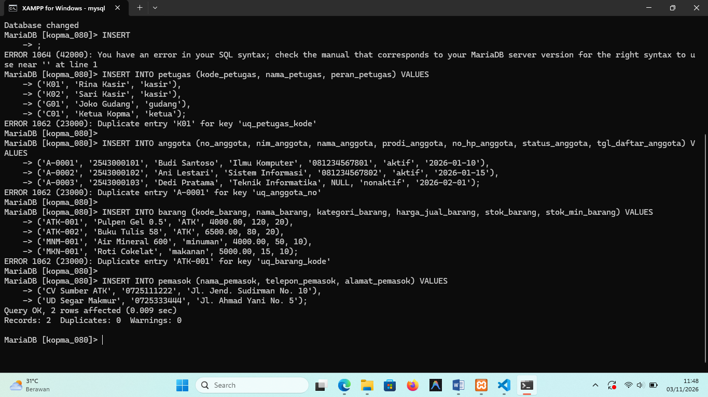
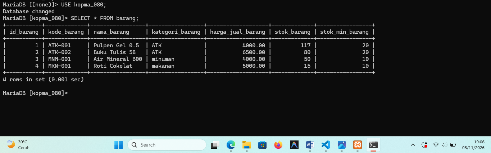
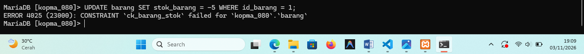

# Laporan Praktikum Basis Data - Pertemuan 6

**Nama:** Nia Septiana  
**NIM:** 25430080  
**Kelas:** C  
**Tanggal:** [3 November 2026]  
**Dosen Pengampu:** Dedi Irawan, S.Kom., M.T.I. 

## 1. Tujuan Praktikum

1. Menambah data ke dalam basis data Koperasi Mahasiswa Sejahtera (Kopma) menggunakan perintah `INSERT` satu baris, banyak baris, dan `INSERT ... SELECT`.
2. Mengubah dan menghapus data secara aman menggunakan perintah `UPDATE` dan `DELETE` dengan memanfaatkan variabel pengaman `sql_safe_updates = 1`.
3. Menyusun skenario uji positif dan negatif untuk membuktikan bahwa basis data mampu menerima data yang sah serta menolak data yang melanggar batasan (*constraint*).
4. Menyiapkan skrip pengisian data sampel proyek Kopma berbasis parameter $P = 9$ yang dapat dijalankan ulang dari skrip SQL.

## 2. Ringkasan Dasar Teori

Perintah DML (*Data Manipulation Language*) merupakan bagian dari SQL yang digunakan untuk memanipulasi data di dalam tabel. Dalam basis data relasional, pengisian data harus memperhatikan urutan ketergantungan kunci tamu (*foreign key*), di mana tabel master/induk (`petugas`, `anggota`, `barang`, `pemasok`) wajib diisi terlebih dahulu sebelum tabel anak/transaksi (`penjualan`, `detail_penjualan`, `pembelian`, `detail_pembelian`, `mutasi_poin`).

Untuk menghindari kehilangan atau kerusakan data akibat perintah `UPDATE` atau `DELETE` tanpa syarat pengkondisian, MySQL/MariaDB menyediakan variabel `sql_safe_updates`. Ketika mode ini diaktifkan (`SET SESSION sql_safe_updates = 1`), server akan menolak eksekusi perubahan data yang tidak menyertakan klausa `WHERE` berbasis kolom kunci utama (*primary key*) atau kolom berkunci.

Pengujian basis data dilakukan melalui pengujian positif (memastikan data yang mematuhi aturan bisnis diterima) dan pengujian negatif (memastikan data yang melanggar *constraint* ditolak dengan kode galat yang sesuai).

## 3. Hasil Langkah Percobaan

### A. Pengisian Data Master dan Transaksi

Eksekusi pengisian data dilakukan dari skrip `p06_data_kopma_25430080.sql`. Seluruh perintah pengisian data master (`petugas`, `anggota`, `barang`, `pemasok`) dan transaksi (`penjualan`, `detail_penjualan`) berhasil dieksekusi dengan status `Query OK`.




### B. Pengujian Constraint dan Safe Update Mode

Server MariaDB berhasil memvalidasi integritas data:
* Pengubahan stok menjadi negatif ditolak oleh *constraint* `ck_barang_stok` (`ERROR 4025`).
  
* Pengisian nota dengan nomor yang sama ditolak oleh *constraint* `uq_penjualan_nota` (`ERROR 1062`).
* Eksekusi `UPDATE` tanpa syarat `WHERE` ditolak oleh *safe update mode* (`ERROR 1175`).


## 4. Jawaban Titik Analisis

* **Titik Analisis 1:**  
  Penggunaan perintah `INSERT ... SELECT` untuk mengisi `harga_satuan_detail_penjualan` secara langsung dari tabel `barang` jauh lebih aman dibandingkan mengetik nominal harga secara manual. Metode ini mencegah kesalahan input manusia (*human error*) serta memastikan konsistensi harga. Selain itu, nilai harga yang tersimpan di `detail_penjualan` bersifat historis (rekam jejak), sehingga jika harga barang di tabel induk mengalami kenaikan di masa mendatang, nilai transaksi pada nota lama tidak akan ikut berubah (memenuhi Aturan Bisnis AB-04).

* **Titik Analisis 2:**  
  Ketika mencoba menghapus data pada tabel induk (seperti `petugas` atau `anggota`) yang sudah memiliki keterkaitan transaksi di tabel anak (`penjualan`), server akan menolak tindakan tersebut dengan galat `ERROR 1451 (23000): Cannot delete or update a parent row`. Hal ini bertujuan untuk menjaga integritas dan rekam jejak transaksi. Apabila seorang petugas berhenti bekerja atau anggota keluar, solusi yang benar bukan menghapus baris data tersebut, melainkan mengubah status keaktifannya (`status_anggota = 'nonaktif'`).

* **Titik Analisis 3:**  
  Constraint `CHECK` pada tabel tunggal (seperti `ck_detail_qty`) hanya mampu memeriksa batasan nilai pada baris data itu sendiri (misalnya $qty > 0$ dan $qty \le 11$). Constraint ini tidak dapat memeriksa kondisi antar-tabel secara dinamis, seperti membandingkan jumlah barang yang dibeli dengan sisa `stok_barang` yang ada di tabel `barang`. Keterbatasan ini dicatat sebagai **Utang Desain (UJ-10)** dan akan ditangani menggunakan penanganan logika transaksi (*stored procedure* / blok transaksi) pada Modul 14.

## 5. Hasil Latihan dan Modifikasi

Pengarsipan data anggota yang berstatus 'nonaktif' dapat dilakukan secara aman menggunakan gabungan struktur DDL dan DML `INSERT ... SELECT` sebagai berikut:

```sql
-- Membentuk tabel arsip dengan struktur identik
CREATE TABLE IF NOT EXISTS anggota_arsip LIKE anggota;

-- Memindahkan data anggota yang berstatus nonaktif
INSERT INTO anggota_arsip 
SELECT * FROM anggota 
WHERE status_anggota = 'nonaktif';

-- Menghapus data yang telah diarsipkan secara aman
DELETE FROM anggota 
WHERE status_anggota = 'nonaktif' AND id_anggota > 0;
```

## 6. Tugas Mandiri: Milestone Proyek 6

- Berkas data sampel proyek Kopma: `p06_data_25430080.sql`
- Berkas dokumen skenario uji: `p06_uji_25430080.md`

## 7. Pembahasan dan Kendala

Dalam pelaksanaan praktikum Modul 6, kendala yang dihadapi antara lain:
1. **Galat Jalur Berkas (`ERROR: Failed to open file, error: 2`)**: Terjadi saat memanggil skrip SQL dengan perintah `SOURCE` akibat ketidaksesuaian penamaan berkas atau penggunaan tanda garis miring (*slash*). Solusinya adalah menyelaraskan nama berkas menjadi `p06_data_kopma_25430080.sql` atau mengeksekusi kueri secara langsung pada terminal CLI MariaDB.
2. **Pemberitahuan Safe Update Mode (`ERROR 1175`)**: Terjadi saat pengujian perintah `UPDATE` tanpa klausa `WHERE` berkunci. Kendala ini dikonfirmasi sebagai perilaku yang diharapkan untuk membuktikan fitur pengaman basis data bekerja dengan baik.

## 8. Kesimpulan

1. Eksekusi perintah DML (`INSERT`, `UPDATE`, `DELETE`) pada basis data Kopma harus memperhatikan urutan integritas referensial antar tabel induk dan anak.
2. Variabel `sql_safe_updates = 1` efektif mencegah modifikasi data secara tidak sengaja pada tabel tanpa kunci pengaman.
3. Seluruh *constraint* yang dirancang pada DDL Modul 5 berhasil memvalidasi masukan data pada Modul 6, sedangkan validasi dinamis lintas tabel akan dituntaskan pada blok transaksi Modul 14.

## 9. Pernyataan Penggunaan AI

Penggunaan alat bantu AI pada praktikum ini meliputi penyusunan draf skenario pengujian (positif dan negatif), penyesuaian parameter $P = 9$, dan pembentukan format laporan standar berbasis Markdown.

## 10. Bukti Git

- Tautan Repositori: `https://github.com/niaseptiana/basisdata-25430080`
- Hash Commit: `97aee48`

## Checklist Laporan Pertemuan 6

- [x] Identitas laporan lengkap
- [x] Tujuan dan ringkasan teori ditulis dengan jelas
- [x] Tangkapan layar langkah percobaan dan pengujian dilampirkan
- [x] Jawaban Titik Analisis 1, 2, dan 3 lengkap
- [x] Berkas `p06_data_kopma_25430080.sql` dan `p06_uji_kopma_25430080.md` tersedia di repositori
- [x] Berkas `p06_data_25430080.sql` dan `p06_uji_25430080.md` tersedia di repositori